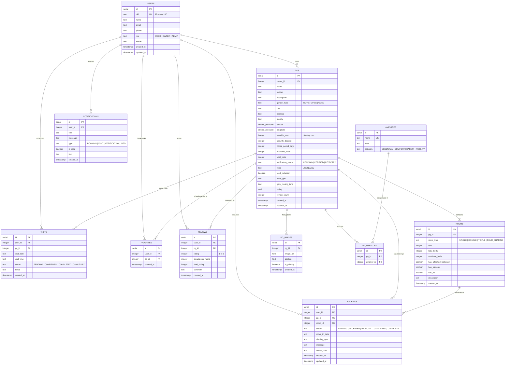

# PGFinder — Entity-Relationship (ER) Diagram & Schema Specification

## 1. Entity-Relationship Diagram (Mermaid)

---

## 2. Table Specifications & Constraints

### 2.1 `users`
- Primary Identifier: `id` (Serial Auto-increment)
- External Key: `uid` (Text, Unique, Not Null) — direct map to Firebase Authentication UID.
- Role Enforcement: `role` text column defaulting to `'USER'`. Allowed values: `'USER'`, `'OWNER'`, `'ADMIN'`.

### 2.2 `pgs`
- Foreign Key: `owner_id` references `users(id)` ON DELETE CASCADE.
- Location Coordinates: `latitude` and `longitude` stored as `double precision` for map clustering, distance calculations, and Google Maps integration.
- Verification Status: `verification_status` with values `'PENDING'`, `'VERIFIED'`, `'REJECTED'`.
- Dynamic Aggregates: `rating` (real) and `review_count` (integer) for high-performance sorting without expensive join-aggregation on every listing query.

### 2.3 `rooms`
- Foreign Key: `pg_id` references `pgs(id)` ON DELETE CASCADE.
- Type categorization: `SINGLE`, `DOUBLE`, `TRIPLE`, `FOUR_SHARING`.
- Real-time inventory tracking: `total_beds` and `available_beds`.

### 2.4 `amenities` & `pg_amenities`
- Normalized many-to-many junction enabling fast filtering by multiple tags (e.g. WiFi, Food, AC, Biometrics, Parking).

### 2.5 `bookings`
- Multi-party lifecycle state machine:
  - `PENDING` -> User submitted request.
  - `ACCEPTED` -> PG owner approved booking.
  - `REJECTED` -> Owner rejected (e.g. no beds left).
  - `CANCELLED` -> User cancelled.
  - `COMPLETED` -> Tenancy commenced.

### 2.6 `visits`
- Physical scheduled tours before booking, linking prospective tenants and PG hosts.
